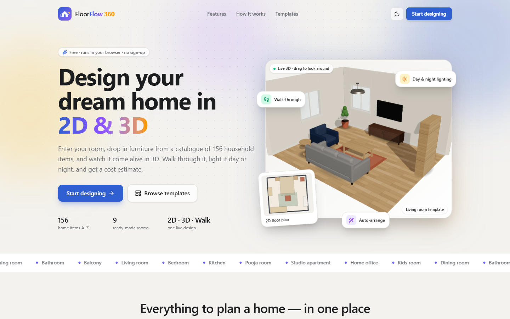
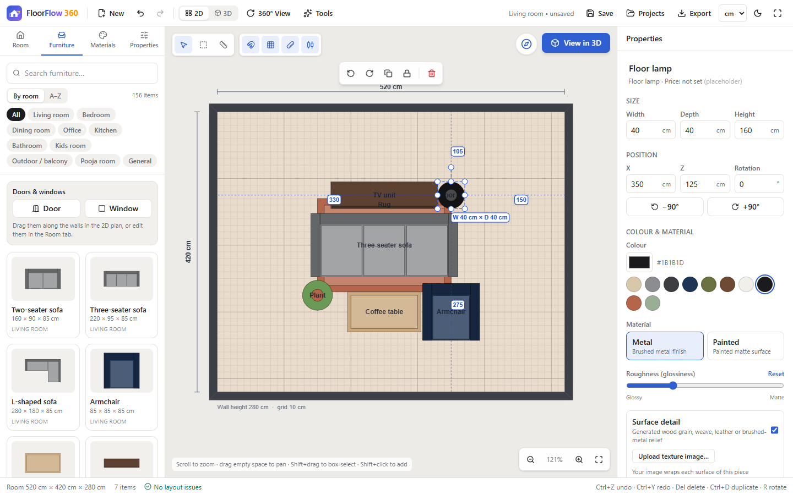
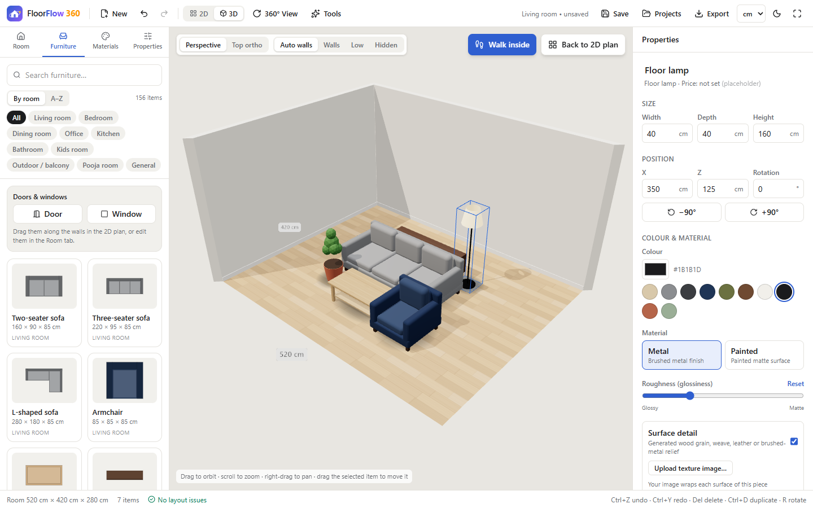

<div align="center">

# 🏠 FloorFlow 360

### Design your dream home in 2D & 3D — right in your browser.

Draw a room, furnish it from **156 household items**, then orbit it, walk through it, light it day or night, and get a cost estimate.
**Free · no sign-up · nothing leaves your device.**




</div>

---

## ✨ Highlights

| | |
|---|---|
| 📐 **Scaled 2D floor plan** | Rectangle, L, T, U or angled rooms. Drag, rotate and resize furniture with snapping, alignment guides and collision warnings. |
| 🧊 **Live 3D, same design** | Orbit, top-down, 360° inspection, or a **first-person walkthrough** with WASD and collisions. |
| 🌗 **Day & night lighting** | Sun position with shadows through windows; lamps that actually light the room at night. |
| 🛋️ **156 items, A → Z** | Sofas to zafu cushions: kitchen, bath, appliances, pooja/mandir, kids, outdoor — browse by room or alphabetically. |
| 🪄 **Auto-arrange & templates** | 9 ready-made rooms and rule-based layouts for 8 room types. |
| 🧭 **Vastu helper** | Direction hints for mandir, cooker, bed, toilet, entrance and more. |
| 🪜 **Multiple floors + stairs** | Stack floors; stairs cut stairwell openings. |
| 💰 **Cost estimate** | Editable prices, tax/discount/currency, **CSV** and **PDF** report. |
| 📸 **Photo studio** | Camera, photo or **360° panorama** upload → style detection and furniture suggestions, plus 11 one-click style presets. |
| 🌐 **Bring your own models** | Import `.glb` files, scaled to real size. |
| 🎨 **Make it yours** | Per-wall colours & patterns, materials, textures, dark mode, cm / m / in / ft. |
| 🔒 **Private by design** | Everything is stored in your browser. JSON export/import for backups. |

<div align="center">


<br/><sub>Left: the scaled 2D plan. Right: the same room in 3D.</sub>
</div>

---

## 🚀 Quick start

```bash
git clone https://github.com/snehasanu64/FloorFlow-360.git
cd FloorFlow-360
npm install
npm run dev        # http://localhost:3000
```

| Command | What it does |
| --- | --- |
| `npm run dev` | Start the dev server |
| `npm run build` / `npm start` | Production build / serve it |
| `npm run lint` | ESLint |
| `npm run typecheck` | `tsc --noEmit` |
| `npm test` | Vitest (242 tests) |

Needs Node 20+ and a browser with WebGL.

## 🧭 How it works

1. **Create a room** — pick a shape and enter dimensions (or start from a template).
2. **Furnish it** — drag items from the catalogue onto the plan; resize, rotate, recolour.
3. **Switch to 3D** — orbit, walk inside, change the time of day.
4. **Plan the details** — auto-arrange, Vastu check, cost estimate, photo-based suggestions.
5. **Save or share** — projects persist in your browser; export JSON, PNG or a PDF report.

## ⌨️ Shortcuts

| Action | Keys |
| --- | --- |
| Undo / redo / save | `Ctrl+Z` / `Ctrl+Y` / `Ctrl+S` |
| Select all / multi-select | `Ctrl+A` / `Shift+click`, `Shift+drag` |
| Copy / cut / paste / duplicate | `Ctrl+C` / `X` / `V` / `D` |
| Group / ungroup / lock | `Ctrl+G` / `Ctrl+Shift+G` / `L` |
| Rotate 90° · Nudge · Delete | `R` · Arrow keys · `Del` |
| Measure | `M`, click two points |
| Walk through | 3D → **Walk inside**, `WASD`, `Shift` to run, `Esc` to exit |

## 🏗️ Under the hood

- **One state, two renderers** — a Zustand store feeds both the React Konva 2D plan and the React Three Fiber 3D scene.
- **One footprint definition** drives 2D shapes, thumbnails and collision, so 2D and 3D always agree.
- **Metres internally**; the UI converts to your chosen unit. Rooms are clockwise polygons with mitred walls.
- **Undo history** per floor; drags and resizes are a single step.
- **Fast 3D** — on-demand rendering, shared procedural textures, a fixed pool of lamp lights, no remote assets.

```
src/
  app/          layout, page, theme tokens (light + dark)
  components/   landing, toolbar, sidebar, editor2d, editor3d, furniture, panels, room, properties
  store/        Zustand store + selectors
  data/         catalogue, templates, indicative pricing
  lib/          geometry, room shapes, auto-layout, vastu, styles, photo analysis, estimate/report, persistence
tests/          Vitest suites (geometry, rooms, floors, templates, auto-layout, vastu, photo, catalogue)
```

**Built with** Next.js (App Router) · React 19 · TypeScript · Tailwind CSS v4 · React Konva · Three.js / React Three Fiber / drei · Zustand · Lucide · jsPDF.

## 🤖 Optional AI photo analysis

The Photo studio works fully on-device (colour and light analysis → closest interior style). If you want Claude to recognise the room type and existing furniture, paste your **own** Anthropic API key. Your photos are then sent to Anthropic with your key; the app does not store them, and keeps the key only if you tick "remember". This path has been tested against a mocked endpoint, not the live API.

## ⚠️ Good to know

- Furniture is procedural 3D (not product photos); prices are **indicative placeholders** — edit them before relying on an estimate.
- Vastu and auto-arrange are rule-based starting points, not professional advice.
- Imported GLBs must be self-contained (no Draco). They live in your browser, so re-import them on another computer.
- Projects are stored in one browser profile — use JSON export to back up or move them.
- Tested in Chromium (Edge) on desktop; touch devices and other browsers haven't been tested.

---

<div align="center">
Made with ❤️ for anyone planning a home. If you like it, ⭐ the repo!
</div>
